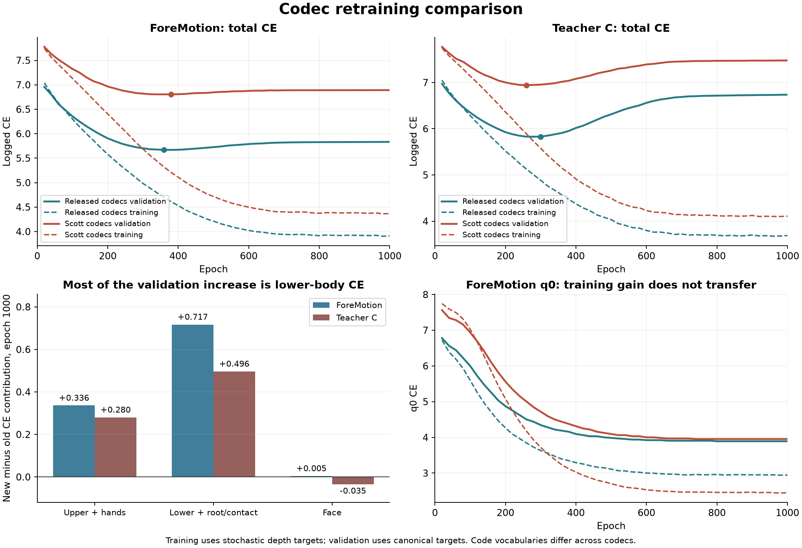

# Scott codec retraining: what changed in the results

The new codecs produce worse logged gesture-model validation CE. Overall training CE is also worse; the improvements are in selected metrics, especially temporal q0 and facial training losses. Lower-body tokens account for most of the validation increase. CE across independently trained vocabularies does not directly rank decoded gesture quality.

## Runs and comparability

Complete W&B histories were retrieved on 2026-09-10, with no missing logged steps. Each gesture run has 50 validation points, ends at epoch 1000, and starts fresh. All four have 320,812,552 trainable parameters, batch 64, seed 2342, 477 training / 54 validation / 89 test clips, face weight 1, independent depth weights, and matching cosine learning-rate histories (start 200, end 800). The behavioral config difference is the three codec checkpoints; two newly registered codec-evaluation flags are false and inactive. Remote source revisions and cache contents have not been independently hashed.

| Model | Released-codec run | Scott-codec run |
| --- | --- | --- |
| ForeMotion | [foremotion-c-face1-cos800-rvq-scott-bs64](https://wandb.ai/wenjye00-hong-kong-university-of-science-and-technology/miburi_single/runs/59fnmnjg) | [foremotion-c-face1-cos800-rvq-scott-bs64-retrain-codec](https://wandb.ai/wenjye00-hong-kong-university-of-science-and-technology/miburi_single/runs/u2zs5s3p) |
| Teacher C | [teacher-c-face1-cos800-supervised-rvq-scott-bs64](https://wandb.ai/wenjye00-hong-kong-university-of-science-and-technology/miburi_single/runs/lqd1cmjh) | [teacher-c-face1-cos800-supervised-rvq-scott-bs64-retrain-codec](https://wandb.ai/wenjye00-hong-kong-university-of-science-and-technology/miburi_single/runs/rmyldw6a) |

Epoch 1000 training meters summarize the preceding final training epoch (999) for all four runs. Training CE mixes hard and soft depth targets with stochastic RVQ prefixes; validation CE scores canonical hard targets. The absolute train–validation difference is therefore not a controlled generalization-gap estimate.

## Overall CE

| Model | Final training CE, old → new | Best validation CE, old → new | Final validation CE, old → new |
| --- | ---: | ---: | ---: |
| ForeMotion | 3.9106 → 4.3659 (+11.6%) | 5.6692 @ 360 → 6.8030 @ 380 (+20.0%) | 5.8328 → 6.8906 (+18.1%) |
| Teacher C | 3.6884 → 4.1066 (+11.3%) | 5.8273 @ 300 → 6.9410 @ 260 (+19.1%) | 6.7359 → 7.4773 (+11.0%) |

## Where the validation difference comes from

The part scores below are contributions to total CE (summed head losses divided by 20). They sum to overall CE. Upper/lower each contain eight heads and face four; these are not equal-size per-part averages.

| Model | Upper contribution change | Lower contribution change | Face contribution change | Lower share of total increase |
| --- | ---: | ---: | ---: | ---: |
| ForeMotion | +0.3363 | +0.7170 | +0.0045 | 67.8% |
| Teacher C | +0.2803 | +0.4964 | -0.0353 | 67.0% |

ForeMotion face validation is almost unchanged; the new teacher face validation is slightly better at epoch 1000. A face-only explanation does not fit this comparison.

## Better q0 training is a limited improvement

| Model | Training q0 CE, old → new | Validation q0 CE, old → new | Validation q0 accuracy, old → new |
| --- | ---: | ---: | ---: |
| ForeMotion | 2.944 → 2.446 | 3.891 → 3.953 | 24.40% → 18.95% |
| Teacher C | 2.987 → 2.513 | 3.906 → 3.938 | 24.15% → 19.07% |

q0 is the first upper-body code, not a summary of all temporal features. The new model fits those training labels more tightly, but this does not transfer to held-out labels. Its q0 validation still improves during training; these observations alone do not prove earlier temporal overfitting.

## Codec reconstruction versus the previous ground-truth audit

The selected checkpoints are upper epoch 990, lower 970, face 1000. These match the best logged selection metric for each codec through epoch 1000, so the filenames `last_*` do not mean an arbitrary worse checkpoint was chosen. W&B marks the three long codec runs crashed around epochs 1001–1005 despite a configured 2000-epoch budget; the state alone does not distinguish a manual stop from a runtime failure.

The previous export and new codec validation both use 54 clips / 13,500 frames, complete-clip streaming, all frames, and no warmup removal. The following feature metrics have matching definitions. Exact remote clip IDs and cache hashes should be checked in a paired rerun before treating this as a fully controlled benchmark.

| Reconstruction metric | Released codec | Selected Scott codec | Relative change |
| --- | ---: | ---: | ---: |
| Expression RMSE | 0.064613 | 0.077402 | +19.8% |
| Contact RMSE | 0.059862 | 0.104074 | +73.9% |
| Direct root-velocity RMSE (m/s) | 0.019615 | 0.020077 | +2.4% |

Previous measurements: `C:/Users/WenJChai/Downloads/codec_audit_20260910_072514_524748/reconstruction_summary.csv`, filtered to validation, all_frames and streaming. New measurements: the selected epochs in the [lower codec run](https://wandb.ai/wenjye00-hong-kong-university-of-science-and-technology/miburi_single/runs/akld8gc6) and [face codec run](https://wandb.ai/wenjye00-hong-kong-university-of-science-and-technology/miburi_single/runs/j4taovlj).

Do not compare old geodesic rotation error or MPJPE with new raw rotation-6D MSE. No matching new geometry metrics are logged, and none of the four gesture runs logs generated-motion eval metrics.

## Interpretation

1. **The learned targets changed.** An independently trained RVQ divides motion into different categories and residuals. Same vocabulary size does not imply the same entropy or predictability from speech/history. Smaller q0 training CE can coexist with worse held-out CE. Token CE is not a cross-codec motion-quality score.

2. **The Scott codecs have not demonstrated better reconstruction.** Contact and expression errors are worse in the available comparable measurements. Their reconstruction curves generally keep improving toward epoch 1000; this is not evidence that the codec itself overfit earlier. Scratch training on 477 clips replaces a codec trained on the broader full-BEATX data distribution. The new run also uses FP32 latents whereas the saved release training recipes used BF16.

3. **The lower-code representation is the first suspect.** Most added CE comes from lower-body tokens in both ForeMotion and supervised teacher, which share the new codecs but differ in regret supervision. Harder/unfamiliar lower token sequences or codec-specific fitting to the training set are plausible; code usage, per-stage entropy and token transitions are needed to distinguish them. Contact reconstruction error does not by itself prove the cause of the lower-token CE increase.

4. **A simple stronger-overfitting claim is incomplete.** The new best CE is already higher. From best to final, ForeMotion deteriorates 2.89% with old codecs versus 1.29% with new; teacher 15.59% versus 7.73%. Teacher depth still shows within-run overfitting, but the new post-best deterioration is smaller. Earlier stopping alone cannot recover the previous best CE.

5. **The measured RVQ perturbation is similar.** Average top-k target entropy is about 1.610 versus 1.614 nats, sampled non-nearest fraction about 8.4% versus 8.2%, and changed-code fraction about 25.9% versus 26.1%. This is local candidate entropy, not global code-usage entropy. These diagnostics do not support a large accidental increase in augmentation strength.

The logged yaw flag differs between codec and gesture configs, but current BaseCausalCodecTrainer and BaseGLMTrainer do not pass it to UNIFIEDDataset; its constructor default is false. The cache builder already aligns each chunk. Thus the config flag alone is not evidence of a preprocessing mismatch. Likewise motion tokens are encoded from motion online, so rebuilding the existing motion/speech cache is not the missing step.

## Next evaluation

First run the same reconstruction audit on both codec sets with exactly the same validation manifest, then test after selecting the codec configuration. Include geodesic error, MPJPE, integrated root error, contact/expression error, and per-stage usage/entropy/unseen-token mass. A canonical teacher-forced pass on both train and validation would make the within-codec token generalization gap interpretable.

For the first downstream ablation, keep the original upper/face codecs and replace only lower. Compare it with the existing original-codec baseline and the all-new run. This isolates the largest contributor without replacing all vocabularies simultaneously. Evaluate autoregressively generated motion from each run’s validation-selected checkpoint with the same FGD/geometry/protocol, rather than judging by CE alone. If single-speaker adaptation is still desired, fine-tuning released codecs is a separate, useful comparison to training them from scratch.

No training, checkpoint or configuration files were changed during this analysis.
